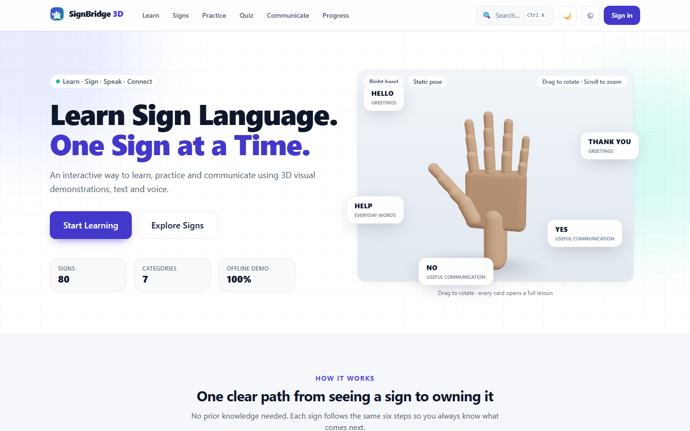
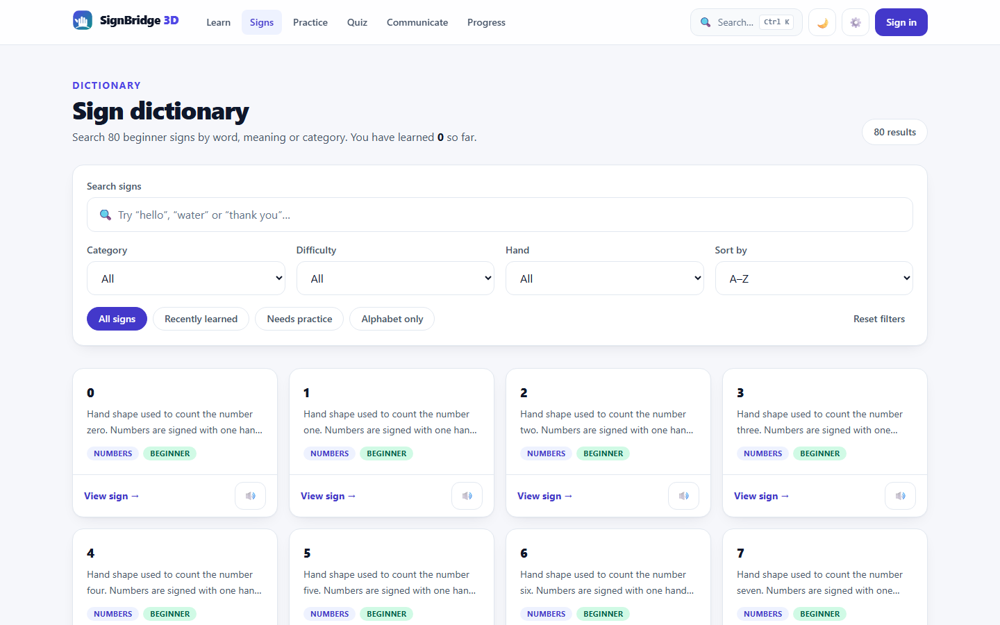
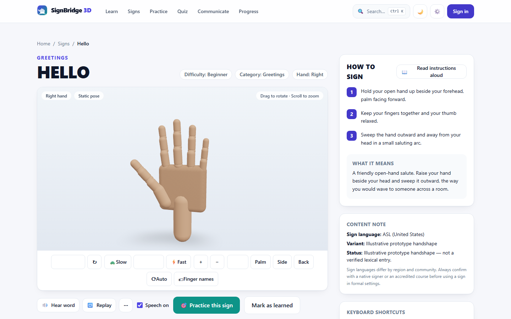
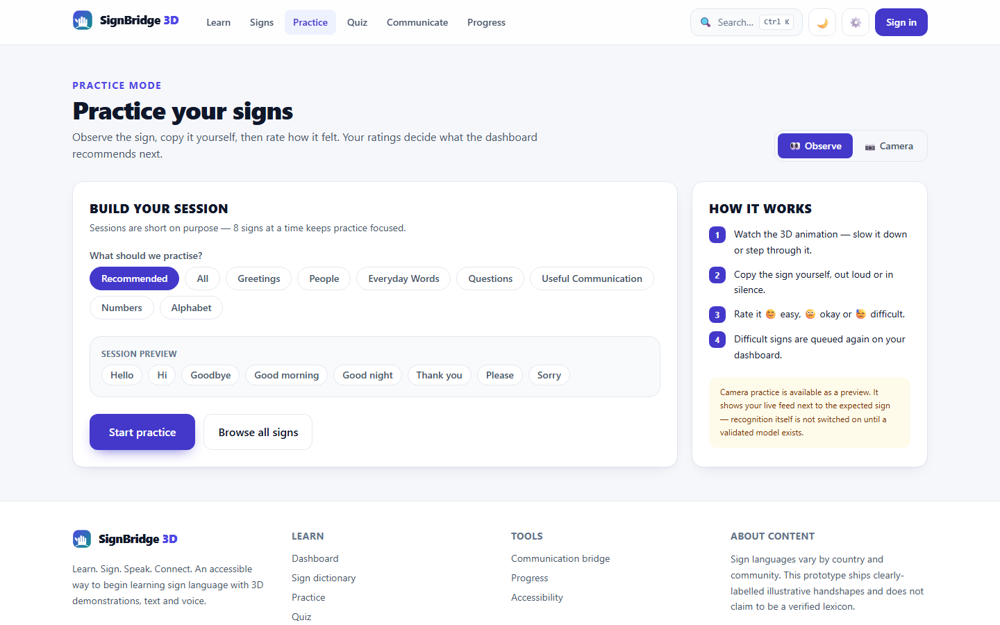
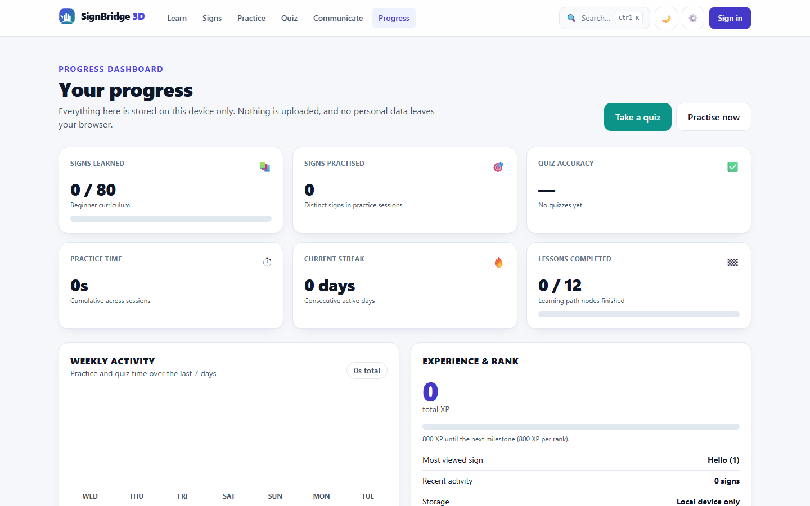
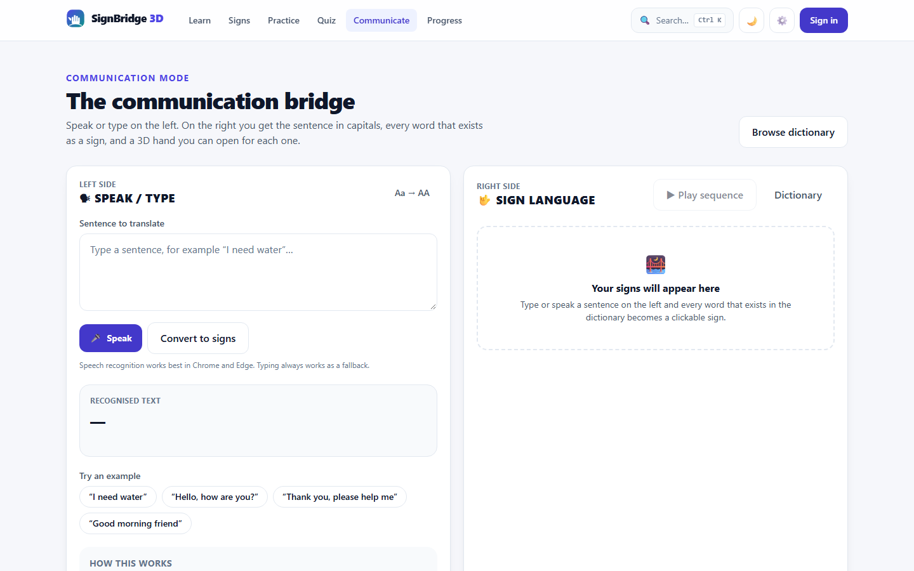

# SignBridge 3D

**Learn. Sign. Speak. Connect.**

An accessibility-first sign-language learning platform built with React, TypeScript, Vite, Tailwind CSS and an interactive 3D hand rig rendered with React Three Fiber.

SignBridge 3D combines a searchable sign dictionary, a guided beginner curriculum, practice sessions, quizzes, text-to-speech / speech-to-text tools and a "communication bridge" that turns a spoken or typed sentence into a sequence of signs — all wrapped in a UI designed for keyboard, screen-reader and low-vision users from the very first commit.

> **Honest content notice.** Every handshape in this repository is an **illustrative sample** (`sample: true`, `language: 'ASL'`, `region: 'United States'`). Sign languages vary by country, region and community. This prototype does **not** claim to be a verified lexicon, and the camera-practice engine reports `modelStatus: 'unavailable'` rather than fabricating confidence scores. ISL and BSL are modelled in the data layer but are marked *coming soon* and disabled until content is reviewed with native signers.

---

## Table of contents

- [Live demo](#live-demo)
- [Screenshots](#screenshots)
- [Features](#features)
- [Tech stack](#tech-stack)
- [Getting started](#getting-started)
- [Environment variables](#environment-variables)
- [Commands](#commands)
- [Architecture](#architecture)
  - [3D hand rig](#3d-hand-rig)
  - [State](#state)
  - [Accessibility](#accessibility)
  - [Speech](#speech)
  - [Recognition engine](#recognition-engine)
- [Testing and verification](#testing-and-verification)
- [Deployment](#deployment)
- [Project structure](#project-structure)
- [Roadmap](#roadmap)
- [Contributing](#contributing)
- [License](#license)

---

## Live demo

| | |
|---|---|
| Production | https://signbridge-3d.vercel.app |
| Source | https://github.com/deepsh3969/signbridge-3d |
| Local dev | `http://localhost:5173` after `npm run dev` |

The production deployment was verified headlessly: all 13 routes plus a mobile
viewport render with **no console or page errors**.

---

## Screenshots

| Landing | Dictionary |
|---|---|
|  |  |

| Sign detail with 3D viewer | Practice |
|---|---|
|  |  |

| Progress dashboard | Communication bridge |
|---|---|
|  |  |

Mobile layouts are captured too — see `screenshots/mobile-*.png`.

---

## Features

**Learn**
- 12-node beginner learning path across 4 levels (Foundations → Communication Practice) with XP-gated unlocking.
- 80-sign dictionary covering Greetings, People, Everyday Words, Questions, Useful Communication, Numbers 0–10 and the full A–Z alphabet.
- Search by word, meaning or keyword; filter by category, difficulty and handedness; sort A–Z, by popularity or by relevance.
- "Recently learned" and "Needs practice" smart filters fed by your own ratings and quiz misses.

**3D viewer**
- Procedural 21-joint hand rig — no model downloads, no WebGL assets, works offline.
- Front / palm / side / back camera presets, zoom, auto-rotate, finger labels and a step-through mode.
- Speed control tied to the global animation-speed preference; reduced motion is respected.
- Two-handed signs render an off-hand pose; every sign has a keyframed animation clip.
- Graceful fallback message when WebGL is unavailable.

**Practice**
- Observe → copy → self-rate flow (easy / okay / difficult) with 8-sign sessions.
- Difficult signs are re-queued on the dashboard and surfaced by the *Needs practice* filter.
- Camera mode opens a live preview **next to** the expected sign; the recognition engine interface is pluggable and explicitly reports that no validated model is loaded.

**Quiz**
- Three question types in one round: identify the sign, match the word to a handshape, order a sequence.
- Standard (10 questions, instant feedback) and Timed (60-second challenge) modes.
- Results show score, accuracy, time, a mistake list and links back to each sign.

**Communicate**
- Speech-to-text with a typing fallback (Chrome / Edge Web Speech API).
- Sentence → token → sign matching with a synonym map (`thanks` → *thank you*, `my` → *I*, `drink` → *water*…).
- Playable sign sequence, per-word links into the dictionary, and an explicit "how this works" panel.

**Progress**
- XP, ranks, sign-up streak, weekly activity chart, practice time, quiz accuracy and lessons completed.
- 8 understated achievements (no confetti spam).
- Everything is stored **on the device** (`localStorage`) — nothing is uploaded.

**Accessibility**
- Font size (S/M/L/XL), high contrast, dark mode, captions, reduced motion.
- Text-to-speech on every word and instruction, adjustable speech rate, preferred voice picker.
- Sound effects are optional and never required to learn.
- Full keyboard operation: skip link, visible focus, `Ctrl+K` command palette, `/` search, `M` mute TTS, `Space` play/pause animation, `R` reset view, `C` camera practice, `←`/`→` previous/next sign.
- Semantic landmarks, one `h1` per page, labelled controls, `role="switch"` / `role="radio"` patterns and heading-order tests.

---

## Tech stack

| Layer | Choice |
|---|---|
| UI | React 18, TypeScript 5.6, React Router 6 |
| Build | Vite 5, `@vitejs/plugin-react`, code-split routes, manual `three`/`vendor` chunks |
| Styling | Tailwind CSS 4 (`@tailwindcss/vite`) with a token-driven design system |
| 3D | three.js, `@react-three/fiber`, `@react-three/drei` |
| Animation | framer-motion (page/section reveals), hand-authored keyframe rig for hands |
| State | Zustand 5 with `persist` middleware |
| Speech | Web Speech API (SpeechSynthesis + SpeechRecognition) |
| Tests | Vitest 2, Testing Library, jsdom |
| Visual QA | puppeteer-core driving the system Chrome (screenshot + console-error pass) |

---

## Getting started

```bash
# 1. install dependencies
npm install

# 2. start the dev server
npm run dev            # http://localhost:5173

# 3. (optional) run the tests and type check
npm test
npm run typecheck
```

Requirements: **Node 18+** (developed on Node 22), npm 9+.

No environment variables are needed — the whole experience runs locally.

---

## Environment variables

Everything is optional. Copy `.env.example` to `.env` only if you want to explore the cloud-sync integration point:

```bash
VITE_SUPABASE_URL=        # Supabase project URL
VITE_SUPABASE_ANON_KEY=   # PUBLIC anon key only — never the service_role key
```

`src/utils/supabase.ts` documents the ten tables a backend would need
(`profiles`, `signs`, `lessons`, `user_progress`, `practice_sessions`, `quiz_attempts`, `achievements`, `user_achievements`, `user_settings`) and returns `null` in Demo Mode.

---

## Commands

| Command | What it does |
|---|---|
| `npm run dev` / `npm start` | Vite dev server with HMR |
| `npm run build` | Type-check then production build into `dist/` |
| `npm run preview` | Serve `dist/` locally (default port 4173) |
| `npm test` | Run the Vitest suite once |
| `npm run test:watch` | Vitest in watch mode |
| `npm run typecheck` / `npm run lint` | Strict TypeScript check (no emit) |
| `npm run audit:content` | Data-integrity audit: unique ids, related-sign links, animation clips, curriculum coverage |
| `npm run verify` | Headless-browser smoke pass over every route + screenshots (`BASE_URL` env var supported) |

---

## Architecture

### 3D hand rig

```
src/three/handRig.ts      pose library + interpolation + animation registry
src/three/animations.ts   one define() call per sign clip (50+ clips)
src/components/3d/…       HandModel, HandControls, SignHandViewer
```

- The hand is a **flat joint buffer**: slot `0` is the wrist, `1–4` the thumb, then `spread + 3 curls` per finger. Nothing is loaded from disk, so there is no asset licensing or download step.
- `POSES` holds named shapes (`neutral`, `open`, `fist`, `wave`, `chinTouch`, …). Clips are keyframes of `{ pose, dur }`, resolved at render time.
- `interpolatePose(a, b, t)` blends every joint linearly, which means slow motion, step-through and speed multipliers are all the same mechanism.
- The animation timeline is evaluated inside `useFrame`, so playback never triggers a React re-render per frame.
- Loop clips (`hello`, `goodbye`, `please`, …) append their first pose when the last pose differs, so waves repeat seamlessly.
- `FALLBACK_ANIMATION` guarantees a missing clip can never break a page.

### State

| Store | Persistence key | Contents |
|---|---|---|
| `useSettings` | `signbridge.settings` | font size, contrast, dark mode, captions, reduced motion, TTS, speech rate/voice, animation speed, sign language, onboarding |
| `useProgress` | `signbridge.progress` | learned signs, ratings, practice counts/seconds, XP, streak, activity, quiz history, achievements |
| `useAuth` | `signbridge.auth` | local demo account (no password is stored server-side; there is no server) |

Selectors (`toStats`, `selectNeedsPractice`, `selectWeeklyActivity`) keep derived data out of the store.

### Accessibility

- `useApplySettings` maps preferences onto `<html>` data attributes consumed by `src/index.css` (font scale, high contrast, dark mode, reduced motion).
- `usePrefersReducedMotion` gives components a live signal so auto-rotation and page transitions switch off automatically.
- Structural guarantees are enforced by `src/test/pages.test.tsx`: exactly one `h1`, no skipped heading levels, no unnamed buttons, no unlabelled form controls.

### Speech

- `useSpeech` wraps `SpeechSynthesis` with start/end/error callbacks, voice loading and an explicit *unsupported* path — the written word is always on screen, speech is never the only channel.
- `useSpeechRecognition` wraps `SpeechRecognition` / `webkitSpeechRecognition`, reports `unsupported`, `denied` and `error` states, and the Communicate page always keeps typing as a fallback.

### Recognition engine

`src/components/practice/SignRecognitionEngine.ts` defines the contract:

```ts
interface SignRecognitionEngine {
  readonly modelStatus: 'unavailable' | 'loading' | 'ready';
  start(stream: MediaStream): Promise<void>;
  onFrame(video: HTMLVideoElement): Promise<RecognitionResult>;
  stop(): void;
}
```

The shipped `PlaceholderEngine` returns `modelStatus: 'unavailable'` with **no scores**. Swapping in a real model (MediaPipe Hands, TF.js, ONNX) is a single-file change; the UI already renders loading / ready / error states honestly.

---

## Testing and verification

```bash
npm test               # 70 unit + component + accessibility tests
npm run typecheck      # strict TypeScript
npm run audit:content  # dictionary / curriculum / animation integrity
npm run build          # production bundle
npm run verify         # headless route pass + screenshots (needs `npm run preview`)
```

`npm run verify` walks all 13 routes plus a mobile viewport, captures `screenshots/*.png`, fails on any console error or page error, and dismisses the first-run onboarding before shooting.

Content integrity is also enforced in CI-friendly form by `src/test/content.test.ts` (unique ids, every `relatedSigns` target resolves, every `animationId` has a clip, every clip references a real pose, the curriculum covers the dictionary exactly).

---

## Deployment

The app is a static SPA — any static host works.

**Vercel**

```bash
npm i -g vercel
vercel            # first run: link/create the project
vercel --prod     # production deployment
```

Framework preset: **Vite** · Build command: `npm run build` · Output directory: `dist`.

Because routing is client-side, no extra rewrite config is required for Vercel's Vite preset (it serves `index.html` for unknown paths). If you deploy elsewhere, add an SPA fallback rewrite.

**GitHub Pages / Netlify** — same `dist/` output; add the SPA rewrite rule for your host.

---

## Project structure

```
signbridge-3d/
├── public/favicon.svg
├── scripts/
│   ├── content-audit.mjs    # data-integrity audit
│   └── verify.mjs           # headless browser smoke pass + screenshots
├── screenshots/             # README + QA screenshots
├── src/
│   ├── components/
│   │   ├── 3d/              # HandModel, HandControls, SignHandViewer
│   │   ├── accessibility/   # AccessibilityPanel, TextToSpeech, ReadAloud
│   │   ├── communication/   # SpeechToText, CommunicationBridge
│   │   ├── dashboard/       # ProgressCard, ProgressChart
│   │   ├── layout/          # AppShell, Navbar, Logo
│   │   ├── learning/        # SignCard, LearningPath
│   │   ├── practice/        # CameraPractice, PracticeSession, SignRecognitionEngine
│   │   ├── quiz/            # QuizEngine, QuizCard
│   │   ├── ui/              # Reveal, ButtonLink
│   │   ├── CommandPalette.tsx
│   │   └── Onboarding.tsx
│   ├── data/                # signs, lessons, achievements
│   ├── hooks/               # useSpeech, useAccessibility
│   ├── pages/               # one file per route
│   ├── store/               # settings, progress, auth (zustand)
│   ├── test/                # vitest suites + setup
│   ├── three/               # handRig, animations
│   ├── types.ts
│   └── utils/               # audio, supabase
├── index.html               # SEO, OG, JSON-LD, noscript
├── vite.config.ts
└── package.json
```

---

## Roadmap

- [ ] Community review of the illustrative handshapes with Deaf/native signers before any content is called "verified".
- [ ] Real recognition model behind `SignRecognitionEngine` (MediaPipe / ONNX) with calibrated confidence thresholds.
- [ ] ISL and BSL content tracks, disabled until reviewed.
- [ ] Supabase sync for progress, accounts and cross-device continuity.
- [ ] Regional variant flags per sign (already modelled in the `Sign` type).
- [ ] Offline PWA with a service worker for low-connectivity learners.
- [ ] Per-letter fingerspelling drills and receptive-speed training.

---

## Contributing

1. Fork and create a feature branch.
2. Keep the accessibility invariants intact: one `h1` per page, labelled controls, keyboard reachable, no colour-only meaning.
3. Never add content that is not clearly labelled as sample or reviewed data.
4. Run `npm test && npm run typecheck && npm run audit:content` before opening a PR.
5. Screenshots for UI changes: `npm run build && npm run preview`, then `npm run verify`.

---

## License

MIT © SignBridge 3D
